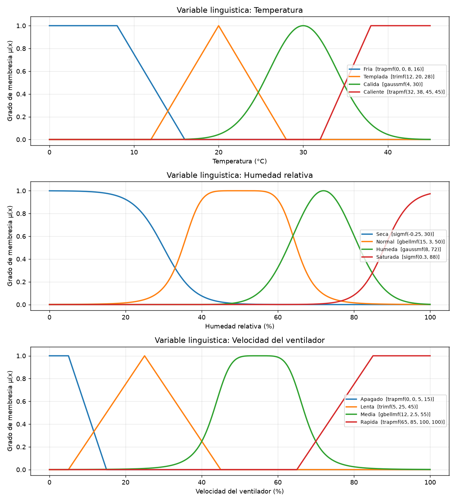
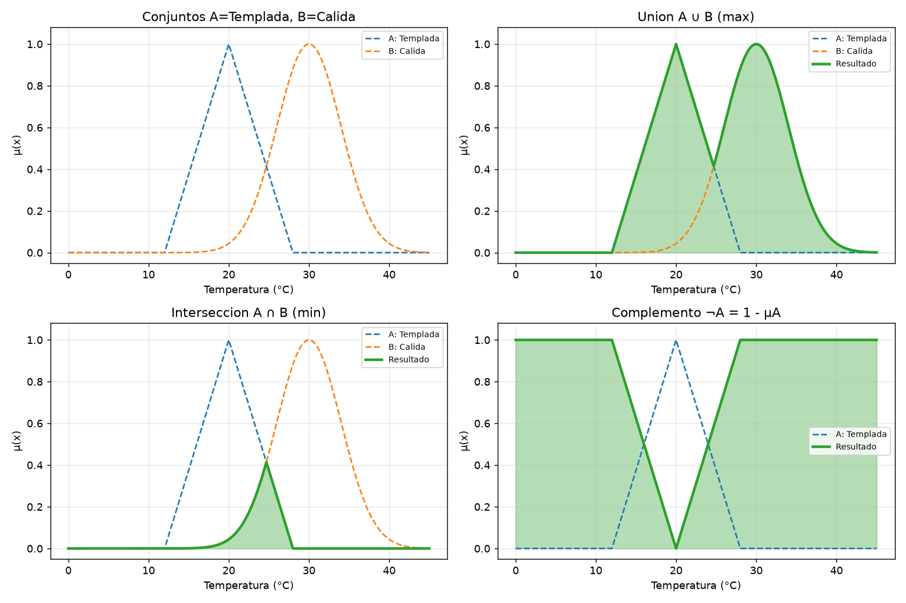
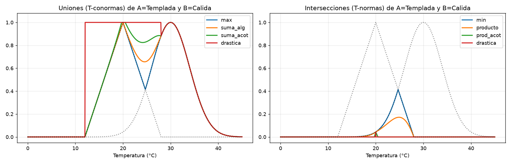
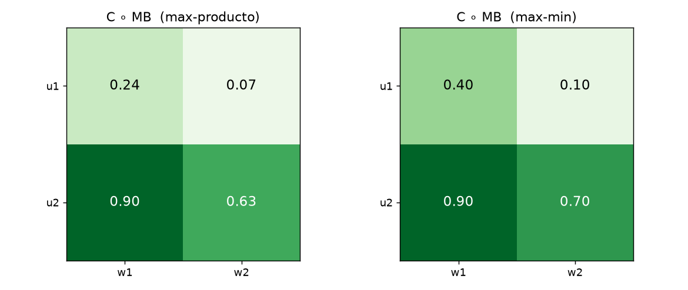

# Sistemas Difusos - Conjuntos tipo 1, operadores y composición

Práctica de Cómputo Suave (UABC - FCQI). Implementación propia en Python
(NumPy + Matplotlib) de funciones de membresía, variables lingüísticas,
operadores difusos y composición sup-star.

## Estructura

| Archivo | Contenido |
|---|---|
| `difuso.py` | Librería: MFs (`trimf`, `trapmf`, `gaussmf`, `gbellmf`, `sigmf`), clase `VariableLinguistica`, `union`, `interseccion`, `complemento`, `composicion` |
| `ejercicio1_variables.py` | 3 variables lingüísticas con 4 términos cada una, mezclando MFs |
| `ejercicio2_operadores.py` | Unión, intersección y complemento (+ comparación de T-normas/T-conormas y propiedades) |
| `ejercicio3_composicion.py` | Composición max-min con R = [[1,0],[0,1]] y S = [[1,0,0],[1,0,1]] |
| `ejercicio4_composicion_producto.py` | Último ejemplo de la presentación con T-norma = producto |
| `main.py` | Ejecuta todos los ejercicios |
| `graficas/` | Imágenes generadas |

## Ejecución

```bash
pip install -r requirements.txt
python main.py
```

## 1. Variables lingüísticas

Contexto: control de clima de un invernadero.

| Variable | Universo | Términos (MF) |
|---|---|---|
| Temperatura | [0, 45] °C | Fría (trapezoidal), Templada (triangular), Cálida (gaussiana), Caliente (trapezoidal) |
| Humedad relativa | [0, 100] % | Seca (sigmoidal), Normal (campana), Húmeda (gaussiana), Saturada (sigmoidal) |
| Velocidad del ventilador | [0, 100] % | Apagado (trapezoidal), Lenta (triangular), Media (campana), Rápida (trapezoidal) |



## 2. Operadores

Una función por operador, cada una con varias definiciones vistas en clase:

- `union(mu_a, mu_b, tipo)`: `max`, `suma_alg` (a+b−ab), `suma_acot` (min(1, a+b)), `drastica`
- `interseccion(mu_a, mu_b, tipo)`: `min`, `producto` (ab), `prod_acot` (max(0, a+b−1)), `drastica`
- `complemento(mu_a)`: 1 − μA




Se verifica conmutatividad, involución y leyes de De Morgan; también se muestra
que la ley del tercero excluido (A ∪ ¬A = X) **no** se cumple en lógica difusa.

## 3. Composición sup-star

μ<sub>R∘S</sub>(u, w) = max<sub>v</sub> [ μ<sub>R</sub>(u, v) ⋆ μ<sub>S</sub>(v, w) ]

Con R = [[1, 0], [0, 1]] (identidad) y S = [[1, 0, 0], [1, 0, 1]]:

```
R ∘ S = [[1, 0, 0],
         [1, 0, 1]]   (= S, como se espera al componer con la identidad)
```

También se valida con el ejemplo crisp de la presentación (R1 ∘ R2 = T).

## 4. Composición con T-norma = producto

μc(u,v) = [[0.9, 0.4, 0.1], [0.1, 0.4, 0.9]],
μmb(v,w) = [[0, 0], [0.6, 0], [1, 0.7]]

| | max-producto | max-min |
|---|---|---|
| (u1, w1) | max(0, 0.24, 0.10) = **0.24** | 0.40 |
| (u1, w2) | max(0, 0, 0.07) = **0.07** | 0.10 |
| (u2, w1) | max(0, 0.24, 0.90) = **0.90** | 0.90 |
| (u2, w2) | max(0, 0, 0.63) = **0.63** | 0.70 |

```
μ(C∘MB) [producto] = [[0.24, 0.07],
                      [0.90, 0.63]]
```



El producto da valores menores o iguales que el mínimo (a·b ≤ min(a, b)),
por lo que la relación resultante es más "estricta"; sólo coinciden cuando
uno de los factores es 0 o 1.
